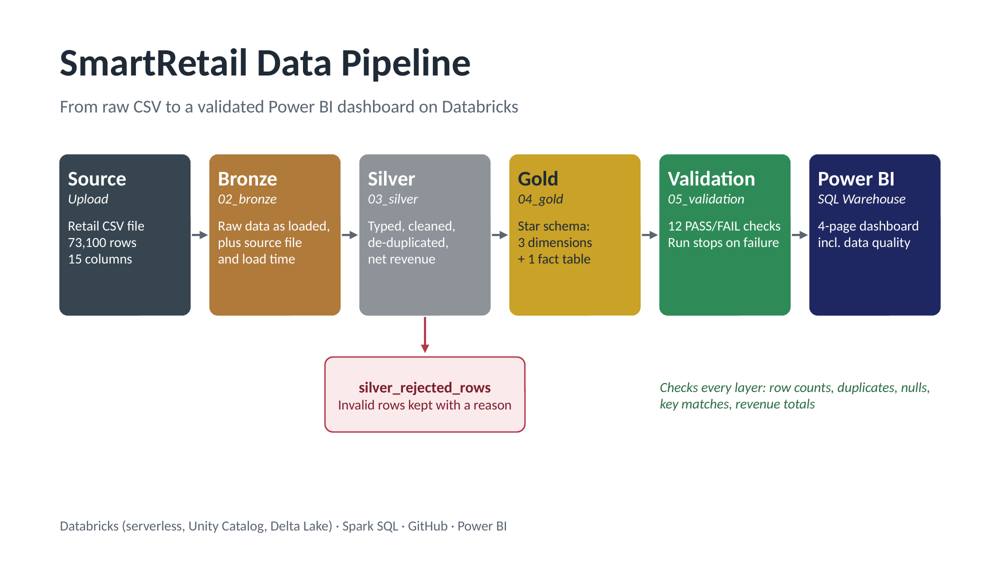
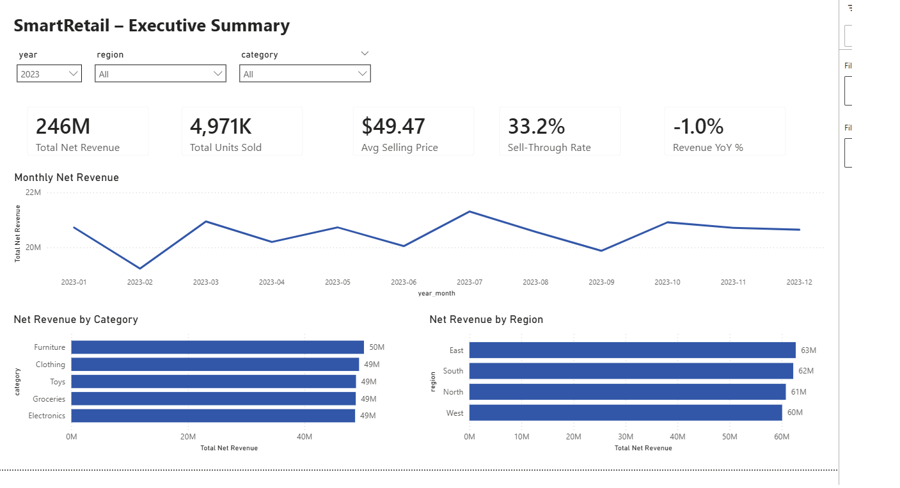
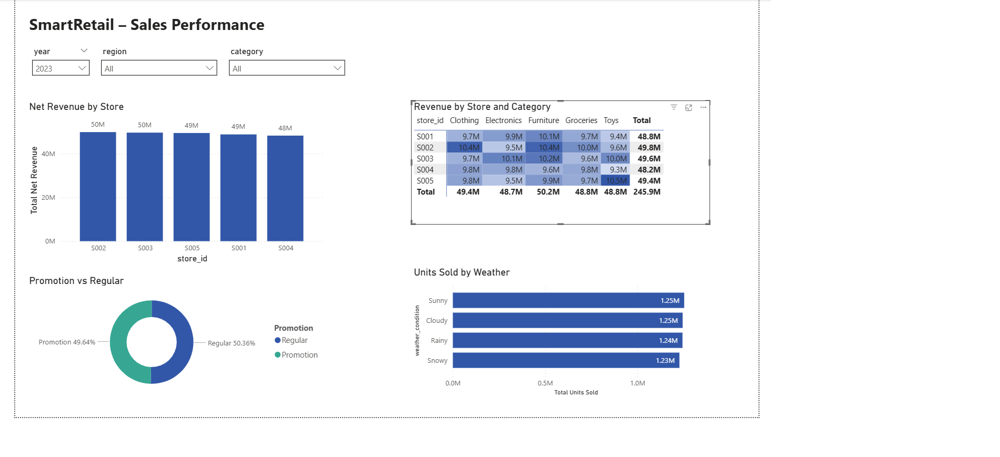
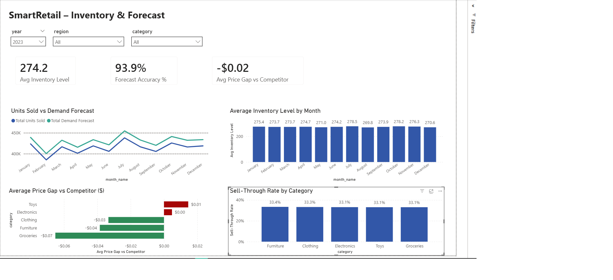
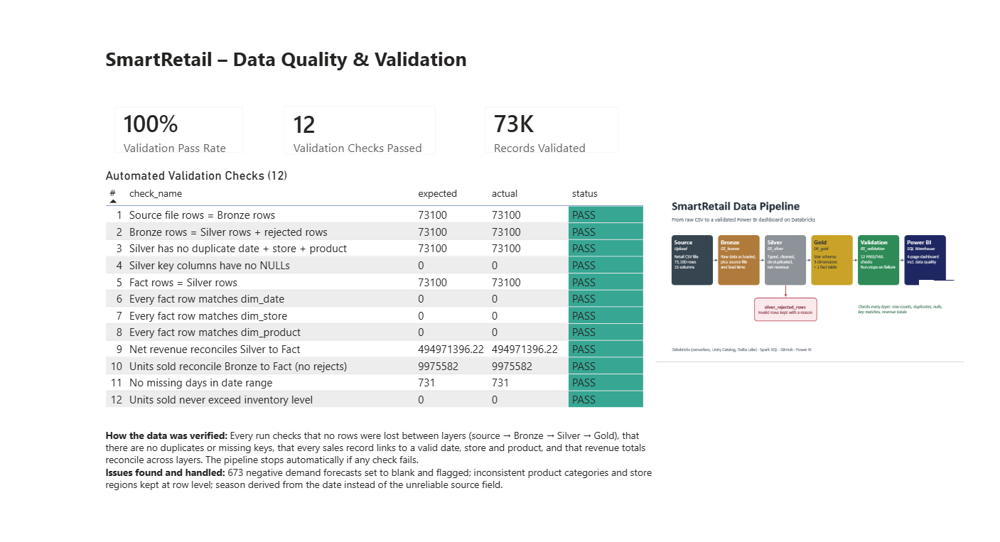

# SmartRetail Databricks Pipeline

End-to-end retail data pipeline on Databricks: raw CSV ingestion → Bronze / Silver / Gold (medallion) layers → automated data validation → Power BI dashboard.

The focus is on **data integrity**: every row is accounted for from the source file to the final star schema, invalid rows are quarantined with a reason, and each run is checked by 12 automated validation tests.



## Dashboard

| Executive Summary | Sales Performance |
|---|---|
|  |  |
| **Inventory & Forecast** | **Data Quality** |
|  |  |

Key findings (2023): net revenue $245.9M, down 1.0% on 2022; promotions drive about 50% of revenue; the demand forecast is 93.9% accurate but runs consistently above actual sales; prices sit within a few cents of competitors.

## Architecture

```
retail_store_inventory_data.csv
        │  upload
        ▼
Unity Catalog volume  (workspace.smartretail.raw_files)
        │  01_ingestion
        ▼
Bronze  bronze_retail_inventory        raw values + audit columns (source file, load time)
        │  03_silver
        ▼
Silver  silver_retail_inventory        typed, standardized, de-duplicated, net revenue
        silver_rejected_rows           invalid rows with a reject reason
        │  04_gold
        ▼
Gold    dim_date · dim_store · dim_product
        fact_store_product_daily       one row per date + store + product
        gold_monthly_region_sales · gold_category_sales
        │  05_validation
        ▼
validation_results / validation_log    12 PASS/FAIL checks per run
        │
        ▼
Databricks SQL Warehouse  →  Power BI semantic model  →  dashboard
```

## Dataset

`data/retail_store_inventory_data.csv`: daily store and product records, **73,100 rows × 15 columns**, from 1 Jan 2022 to 1 Jan 2024 (5 stores × 20 products × 731 days).

Columns: date, store ID, product ID, category, region, inventory level, units sold, units ordered, demand forecast, price, discount, weather condition, holiday/promotion flag, competitor pricing, seasonality.

## What each notebook does

| Notebook | Purpose |
|---|---|
| `01_ingestion` | Creates the schema and a volume for raw files; checks that the CSV is readable and counts source rows |
| `02_bronze` | Loads the CSV unchanged into a Delta table, renames columns to snake_case, adds source-file and load-time audit columns |
| `03_silver` | Casts types, trims and standardizes text, removes duplicates on the natural key, quarantines invalid rows, nulls and flags negative forecasts, calculates net revenue |
| `04_gold` | Builds a star schema (3 dimensions + 1 fact) and two summary tables for reporting |
| `05_validation` | Runs 12 reconciliation and integrity checks, saves results, and fails the run if any check fails |

## Validation checks

1. Source file rows = Bronze rows
2. Bronze rows = Silver rows + rejected rows (nothing lost)
3. No duplicate date + store + product in Silver
4. No NULLs in key columns
5. Fact rows = Silver rows
6. – 8. Every fact row matches `dim_date`, `dim_store` and `dim_product` (referential integrity)
9. Net revenue reconciles Silver → Fact
10. Units sold reconcile Bronze → Fact
11. No missing days in the date range
12. Units sold never exceed inventory level

**Results:** all 12 checks pass. 73,100 rows at every layer, 0 rejected rows, 9,975,582 units sold, and $494,971,396.22 net revenue reconciled exactly from Silver to Fact.

## Data-quality findings

Profiling found issues that a simple load would hide:

- **Unstable attributes:** each product appears under all 5 categories, and each store in all 4 regions. Category and region are therefore kept at row level in the fact table, not on the product and store dimensions.
- **Seasonality doesn't match the calendar:** one date can carry several seasons, so the Gold layer derives season from the date.
- **Negative demand forecasts:** 673 rows. These are set to NULL and flagged (`forecast_was_negative`) rather than deleted.

## How to run

1. Create a Databricks Free Edition account and clone this repo as a **Git folder**.
2. In **Catalog**, run `01_ingestion` once to create `workspace.smartretail.raw_files`, then upload `data/retail_store_inventory_data.csv` to that volume.
3. Run the notebooks in order: `01` → `02` → `03` → `04` → `05`.
4. Check `validation_results`: every check should show **PASS**.
5. Connect Power BI to the Databricks SQL Warehouse and load the Gold tables.

## Power BI

The semantic model uses `fact_store_product_daily` with relationships to `dim_date` (`date_key`), `dim_store` (`store_id`) and `dim_product` (`product_id`), all many-to-one with single-direction filtering. The report has four pages: Executive Summary, Sales Performance, Inventory & Forecast, and Data Quality (validation results). See `powerbi/SmartRetail_Dashboard.pbix` for the report and `powerbi/dax_measures.md` for every DAX measure.

## Tools

Databricks (serverless compute, Unity Catalog, Delta Lake) · Spark SQL · Git / GitHub · Power BI
